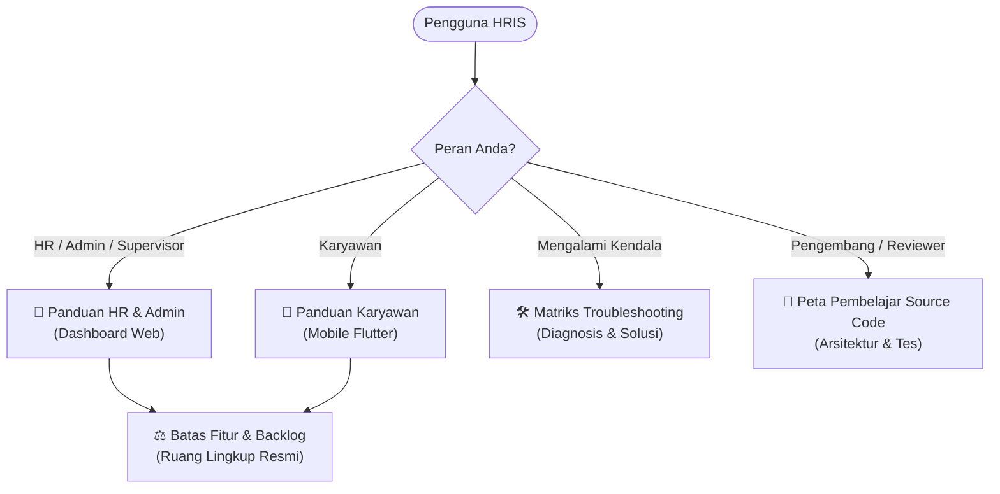

# Dokumentasi Operasional HRIS Naltech Attendance

Tanggal Dokumen: 4 November 2026, Asia/Jakarta.  
Status Dokumen: **Panduan Operasional Resmi (Fitur Tersedia & Terverifikasi)**.  
Acuan Spesifikasi: [`docs/hris-operational-guides-prd.md`](../hris-operational-guides-prd.md).

---

## 1. Pengantar & Tujuan

Dokumentasi ini disusun untuk membantu **Pengelola HR/Admin**, **Atasan/Supervisor**, dan **Karyawan** dalam menjalankan prosedur kerja sehari-hari secara mandiri, aman, dan tepat pada platform Naltech Attendance.

Selain panduan praktis pengguna, direktori ini juga menyajikan materi pemetaan teknis bagi pengembang perangkat lunak atau pembelajar *source code* yang ingin menelusuri implementasi logika bisnis, otorisasi, dan konkurensi di balik antarmuka aplikasi.

> [!IMPORTANT]
> **Prinsip & Batasan Dokumentasi**:
> 1. **Berdasarkan Fitur Aktual**: Seluruh prosedur disusun berdasarkan implementasi kode yang telah ada dan diverifikasi pada Dashboard Web (Laravel 11) dan Mobile (Flutter 3).
> 2. **Bukan Panduan Pengemasan/Rilis Komersial**: Dokumen ini berfokus murni pada penggunaan operasional fitur, bukan pembukaan kembali milestone pengemasan H6, instalasi pembeli, atau deployment server produksi.
> 3. **Status Review Web**: Tampilan Dashboard Web tetap berstatus **Menunggu Review Pengguna** (audit teknis agen selesai); detail pengajuan mobile telah **Disetujui Pengguna** per 4 November 2026.
> 4. **Biometrik Wajah Ditunda**: Fitur verifikasi wajah untuk absensi produksi tetap dinonaktifkan/ditunda sampai tersedianya verifikasi server yang andal.

---

## 2. Peta Dokumen Berdasarkan Peran Pengguna

Pilihlah panduan yang sesuai dengan peran Anda di perusahaan:

| Panduan | Target Pembaca | Cakupan Utama | Berkas Tautan |
|:---|:---|:---|:---:|
| **📘 Panduan HR & Admin** | HR Manager, Super Admin, Admin Unit, & Supervisor | Checklist kesiapan operasional UI, master karyawan, organisasi, kalender kerja, shift efektif, approval bertingkat, koreksi absensi, dan rekapitulasi kehadiran. | [`hr-admin-guide.md`](hr-admin-guide.md) |
| **📱 Panduan Karyawan Mobile** | Seluruh Karyawan (Pengguna Aplikasi Mobile) | Login, membaca jadwal server, check-in/out normal & shift malam, penanganan sesi terkunci >24 jam, pengajuan izin/cuti, lembur, reimbursement, riwayat, dan pembatalan. | [`employee-mobile-guide.md`](employee-mobile-guide.md) |
| **🛠️ Matriks Troubleshooting** | Seluruh Pengguna & Helpdesk HR | Diagnosis 10 kendala umum (login, konflik 409, lokasi/QR, sesi terkunci, saldo cuti, lampiran), tindakan mandiri yang aman, dan protokol eskalasi non-rahasia. | [`troubleshooting.md`](troubleshooting.md) |
| **⚖️ Batas Fitur & Backlog** | Manajemen, HR, & Tim Teknis | Penjelasan transparan mengenai fitur yang tersedia, batas desain teknis, fitur ditunda (biometrik wajah produksi), dan backlog sekunder (rotasi shift, bulk assignment). | [`feature-boundaries.md`](feature-boundaries.md) |
| **🧭 Peta Pembelajar Source Code** | Software Engineer & Technical Reviewer | Arsitektur monorepo, aliran data end-to-end, penegakan otorisasi/multitenancy, mekanisme konkurensi database, dan pemetaan berkas pengujian. | [`source-code-learning-map.md`](source-code-learning-map.md) |

---

## 3. Rujukan Dokumentasi Terkait

Untuk riwayat pengembangan, laporan verifikasi pengujian, dan paket review visual, Anda dapat merujuk ke dokumen-dokumen berikut di direktori `docs/`:

- [**Status Batas Cakupan Fitur (Scope Freeze)**](../hris-feature-scope-status.md): Snapshot kategorisasi status seluruh modul per 4 November 2026.
- [**Paket Review Visual Dashboard Pengguna**](../hris-dashboard-user-review.md): Galeri tangkapan layar PNG aktual pada tema terang/gelap serta desktop/mobile beserta checklist evaluasi.
- [**Laporan Penutupan Review Dashboard**](../hris-dashboard-review-closure-report.md): Rincian evaluasi teknis penerimaan C01–C09 dan hasil eksekusi tes PHPUnit/Flutter.
- [**Timeline Pengembangan HRIS Inti**](../hris-core-timeline.md): Rekam jejak perkembangan tonggak capaian (milestone) H0 hingga penutupan review operasional.
