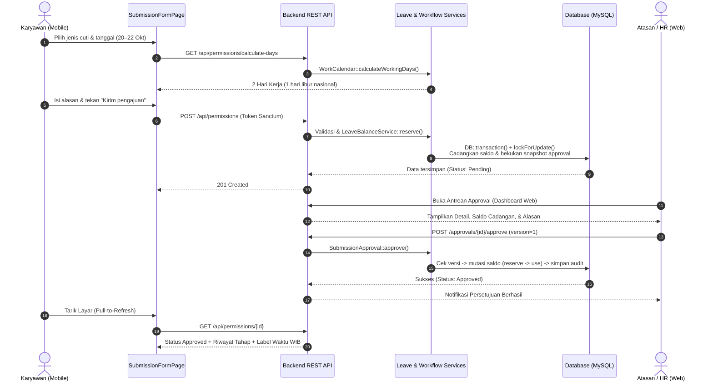

# Peta Pembelajaran Kode Sumber (Source Code Learning Map)

Tanggal Dokumen: 4 November 2026, Asia/Jakarta.  
Status Dokumen: **Panduan Teknis Arsitektur & Penelusuran Kode untuk Pengembang**.  
Acuan Spesifikasi: [`docs/hris-operational-guides-prd.md`](../hris-operational-guides-prd.md) Bagian 7 & 8.

---

## 1. Tata Letak Monorepo (Monorepo Layout)

Repositori Naltech Attendance dikelola dalam bentuk monorepo modular yang memisahkan backend Laravel, aplikasi mobile Flutter, dan dokumentasi spesifikasi secara terstruktur:

```
naltech-attendance/
├── apps/
│   ├── backend/               # Aplikasi Backend (Laravel 10, PHP 8.2, MySQL)
│   │   ├── app/
│   │   │   ├── Http/
│   │   │   │   ├── Controllers/   # Controller Web (Blade) dan API (Sanctum)
│   │   │   │   └── Middleware/    # Otorisasi peran, tenant scoping, auth epoch
│   │   │   ├── Models/            # Eloquent ORM Models
│   │   │   └── Services/          # Domain Business Logic Services (Inti HRIS)
│   │   ├── resources/views/       # Template Antarmuka Blade (Dashboard Web)
│   │   ├── routes/
│   │   │   ├── web.php            # Rute Dashboard Web (Manajemen & HR)
│   │   │   └── api.php            # Rute REST API Mobile (Karyawan)
│   │   └── tests/
│   │       └── Feature/           # Pengujian Integrasi Fitur PHPUnit
│   └── mobile/                # Aplikasi Karyawan (Flutter 3.x, Dart)
│       ├── lib/
│       │   ├── core/              # Utilitas tema, konstanta, format waktu/zona
│       │   ├── data/
│       │   │   ├── datasources/   # Remote REST Datasources & Local SharedPreferences
│       │   │   └── models/        # Data Models & DTO response parsing
│       │   └── presentation/      # Halaman antarmuka (UI) & BLoC State Management
│       └── test/                  # Pengujian Unit & Widget Testing Flutter
└── docs/                      # Dokumentasi PRD, Roadmap, Review, & Panduan Operasional
    ├── operations/            # Panduan Operasional Resmi (HR, Mobile, Troubleshooting)
    ├── screenshots/           # Bukti Tangkapan Layar Tinjauan Visual
    └── hris-core-timeline.md  # Catatan Kronologis Perjalanan Pengembangan
```

---

## 2. Arsitektur Backend & Layanan Domain (Backend Domain Services)

Seluruh aturan bisnis inti diisolasi dalam direktori [`apps/backend/app/Services/`](file:///Users/macbookpro/development/fic/absensi/naltech-attendance/apps/backend/app/Services) guna menjaga controller tetap ramping dan mencegah duplikasi logika:

| Layanan Domain (Service) | Berkas Sumber | Peran & Tanggung Jawab Utama |
|:---|:---|:---|
| **SubmissionApproval** | [`SubmissionApproval.php`](file:///Users/macbookpro/development/fic/absensi/naltech-attendance/apps/backend/app/Services/SubmissionApproval.php) | Mengelola alur persetujuan berjenjang (Tahap 1 Atasan → Tahap 2 HR), pembekuan snapshot peninjau, optimistic locking via `version`, fallback catatan legacy, dan pencatatan audit trail. |
| **AttendanceRecap** | [`AttendanceRecap.php`](file:///Users/macbookpro/development/fic/absensi/naltech-attendance/apps/backend/app/Services/AttendanceRecap.php) | Mengagregasi data absensi per periode (batas maksimum 90 hari), mengecualikan hari libur kalender, memetakan unit kerja saat ini (*current unit*), dan menghasilkan ekspor format CSV. |
| **WorkCalendar** | [`WorkCalendar.php`](file:///Users/macbookpro/development/fic/absensi/naltech-attendance/apps/backend/app/Services/WorkCalendar.php) | Menghitung hari kerja aktif, mengevaluasi aturan mingguan, libur nasional, dan menyediakan fungsi kalkulasi hari kerja efektif untuk pengajuan izin. |
| **EffectiveShift** | [`EffectiveShift.php`](file:///Users/macbookpro/development/fic/absensi/naltech-attendance/apps/backend/app/Services/EffectiveShift.php) | Menentukan penugasan shift aktif berbasis tanggal berlaku (`effective_from`), menyelesaikan baseline perbandingan target date, mendeteksi status "Tanpa Shift", dan shift malam. |
| **LeaveBalanceService** & **LeavePolicy** | [`LeaveBalanceService.php`](file:///Users/macbookpro/development/fic/absensi/naltech-attendance/apps/backend/app/Services/LeaveBalanceService.php), [`LeavePolicy.php`](file:///Users/macbookpro/development/fic/absensi/naltech-attendance/apps/backend/app/Services/LeavePolicy.php) | Mengelola buku besar saldo cuti (*ledger*), alokasi kuota tahunan, pencadangan kuota (*reserve*), pemotongan kuota (*use*), dan pengembalian saldo saat pembatalan (*restore*). |
| **EmployeeLifecycle** | [`EmployeeLifecycle.php`](file:///Users/macbookpro/development/fic/absensi/naltech-attendance/apps/backend/app/Services/EmployeeLifecycle.php) | Mengatur status karyawan (aktif, nonaktif, arsip, reaktivasi), peningkatan `auth_epoch` untuk pembatalan sesi instan, proteksi admin aktif terakhir, dan pencegahan siklus hierarki atasan. |

---

## 3. Arsitektur Aplikasi Mobile (Flutter)

Aplikasi mobile dibangun menggunakan pola **BLoC (Business Logic Component)** dan pemisahan lapisan data:

### 3.1 Lapisan Data (Data Layer)
- **`AuthLocalDatasource`** ([`auth_local_datasource.dart`](file:///Users/macbookpro/development/fic/absensi/naltech-attendance/apps/mobile/lib/data/datasources/auth_local_datasource.dart)): Menyimpan token Sanctum dan profil user aktif di `SharedPreferences`. Menyediakan metode pembersihan sesi bersih saat logout.
- **`SubmissionRemoteDatasource`** ([`submission_remote_datasource.dart`](file:///Users/macbookpro/development/fic/absensi/naltech-attendance/apps/mobile/lib/data/datasources/submission_remote_datasource.dart)): Mengelola pemanggilan REST API untuk modul pengajuan (izin, lembur, reimbursement), kalkulasi hari kerja dinamis (`calculateLeaveDays`), dan pengunduhan gambar lampiran privat berotentikasi.
- **`AttendanceRemoteDatasource`** ([`attendance_remote_datasource.dart`](file:///Users/macbookpro/development/fic/absensi/naltech-attendance/apps/mobile/lib/data/datasources/attendance_remote_datasource.dart)): Menangani check-in dan checkout dengan payload koordinat GPS dan payload QR Code terenkripsi.

### 3.2 Lapisan Presentasi (Presentation Layer)
- **Halaman Beranda (`HomePage`)**: Menampilkan kartu ringkasan jadwal hari ini, zona waktu terlabel, dan tombol aksi absensi.
- **Formulir Pengajuan (`SubmissionFormPage`)** ([`submission_form_page.dart`](file:///Users/macbookpro/development/fic/absensi/naltech-attendance/apps/mobile/lib/presentation/home/pages/submissions/submission_form_page.dart)):
  - Validasi sisi klien instan: menolak file > 2.048 KiB (2.097.152 byte).
  - Preservasi lampiran valid sebelumnya jika penggantian berkas gagal.
  - Perhitungan hari kerja otomatis berdasarkan kalender kerja backend.
- **Daftar & Detail Pengajuan (`SubmissionListPage` & `SubmissionDetailPage`)** ([`submission_list_page.dart`](file:///Users/macbookpro/development/fic/absensi/naltech-attendance/apps/mobile/lib/presentation/home/pages/submissions/submission_list_page.dart)):
  - Pemisahan visual 3 bagian: Catatan Pemohon, Keputusan Terakhir, dan Riwayat Tahap.
  - Retry mandiri lampiran privat tanpa reload seluruh data detail.
  - Penanganan transparan label waktu zona perusahaan vs UTC mentah.

---

## 4. Pola Rancangan & Kontrol Konkurensi Kunci

### 4.1 Multi-Tenancy Ketat (`company_id`)
Seluruh tabel transaksi dan master data (`users`, `shifts`, `permissions`, `attendances`, dll.) wajib menyertakan kolom `company_id`. Kueri database di level backend secara konsisten menggunakan global scope atau pengecekan controller eksplisit guna mencegah kebocoran data lintas perusahaan (*tenant leakage*).

### 4.2 Kontrol Konkurensi Optimistik (Optimistic Concurrency Control)
Untuk mencegah insiden hilangnya data (*lost update*) ketika dua pengelola mengubah data secara bersamaan:
- **`version` pada Karyawan & Approval**: Setiap perubahan menambah nilai kolom integer `version`. Jika versi yang dikirim oleh form tidak cocok dengan versi di database saat eksekusi kueri, server mengembalikan respon **HTTP 409 Conflict**.
- **`expected_id` pada Penugasan Shift**: Mencegah revisi shift menimpa penugasan shift lain yang telah diperbarui oleh administrator kedua di saat bersamaan.
- **Deteksi No-Op**: Jika pengelola menyimpan form tanpa ada perubahan atribut sama sekali, transaksi dibatalkan secara bersih tanpa mencatat log audit palsu.

### 4.3 Pemutusan Sesi Instan via `auth_epoch`
Ketika karyawan diarsipkan atau dinonaktifkan oleh HR, sistem backend menaikkan nilai counter `auth_epoch` pada baris pengguna. Middleware otentikasi Sanctum memeriksa kecocokan `auth_epoch` pada setiap request API. Token lama yang masih aktif seketika menjadi tidak sah (HTTP 401 Unauthorized), memastikan karyawan nonaktif tidak lagi dapat mengakses data perusahaan.

---

## 5. Penelusuran Alur Lengkap: Pengajuan Cuti (End-to-End Trace)

Diagram dan tahapan berikut mengilustrasikan perjalanan lengkap sebuah pengajuan cuti:



---

## 6. Peta Pengujian Otomatis & Cara Verifikasi (Test Suites Map)

Pengembang dapat menjalankan pengujian otomatis untuk memverifikasi fungsionalitas dan mencegah regresi. Seluruh perintah terminal wajib diawali dengan proxy `rtk`.

### 6.1 Rangkaian Uji Backend (PHPUnit Feature Tests)

| Berkas Pengujian | Lokasi Berkas | Fokus Verifikasi |
|:---|:---|:---|
| **H1FlowRefinementTest** | [`tests/Feature/H1FlowRefinementTest.php`](file:///Users/macbookpro/development/fic/absensi/naltech-attendance/apps/backend/tests/Feature/H1FlowRefinementTest.php) | Lifecycle karyawan, arsip, reaktivasi, konflik versi 409, proteksi admin terakhir, audit trail. |
| **EffectiveShiftTest** | [`tests/Feature/EffectiveShiftTest.php`](file:///Users/macbookpro/development/fic/absensi/naltech-attendance/apps/backend/tests/Feature/EffectiveShiftTest.php) | Penugasan shift bertanggal efektif, baseline tanggal target, deteksi tanpa shift, konflik expected_id. |
| **ApprovalFlowRefinementTest** | [`tests/Feature/ApprovalFlowRefinementTest.php`](file:///Users/macbookpro/development/fic/absensi/naltech-attendance/apps/backend/tests/Feature/ApprovalFlowRefinementTest.php) | Alur persetujuan berjenjang, pembekuan snapshot, transaksi ledger saldo cuti. |
| **H5FlowRefinementTest** | [`tests/Feature/H5FlowRefinementTest.php`](file:///Users/macbookpro/development/fic/absensi/naltech-attendance/apps/backend/tests/Feature/H5FlowRefinementTest.php) | Shift malam lintas hari (cross-midnight), penanganan sesi absensi terkunci > 24 jam. |
| **AttendanceCorrectionRecapTest** | [`tests/Feature/AttendanceCorrectionRecapTest.php`](file:///Users/macbookpro/development/fic/absensi/naltech-attendance/apps/backend/tests/Feature/AttendanceCorrectionRecapTest.php) | Koreksi absensi atomik, modal diff, agregasi rekapitulasi kehadiran 90 hari, ekspor CSV. |

**Perintah Menjalankan Uji Backend**:
```bash
# Menjalankan seluruh pengujian fitur utama
rtk php artisan test tests/Feature/H1FlowRefinementTest.php tests/Feature/EffectiveShiftTest.php tests/Feature/ApprovalFlowRefinementTest.php tests/Feature/H5FlowRefinementTest.php tests/Feature/AttendanceCorrectionRecapTest.php
```

### 6.2 Rangkaian Uji Mobile (Flutter Widget Tests)

| Berkas Pengujian | Lokasi Berkas | Fokus Verifikasi |
|:---|:---|:---|
| **submission_refinement_verification_test** | [`test/submission_refinement_verification_test.dart`](file:///Users/macbookpro/development/fic/absensi/naltech-attendance/apps/mobile/test/submission_refinement_verification_test.dart) | Validasi batas ukuran berkas 2.048 KiB, fallback catatan peninjau, tombol retry lampiran privat, isolasi sesi akun, pelabelan zona waktu resmi perusahaan. |
| **submission_approval_mobile_test** | [`test/submission_approval_mobile_test.dart`](file:///Users/macbookpro/development/fic/absensi/naltech-attendance/apps/mobile/test/submission_approval_mobile_test.dart) | Alur persetujuan modul mobile, transisi status approval, tampilan riwayat berjenjang. |

**Perintah Menjalankan Uji Mobile**:
```bash
# Masuk ke direktori mobile dan jalankan pengujian widget
cd apps/mobile
rtk flutter test test/submission_refinement_verification_test.dart
```
