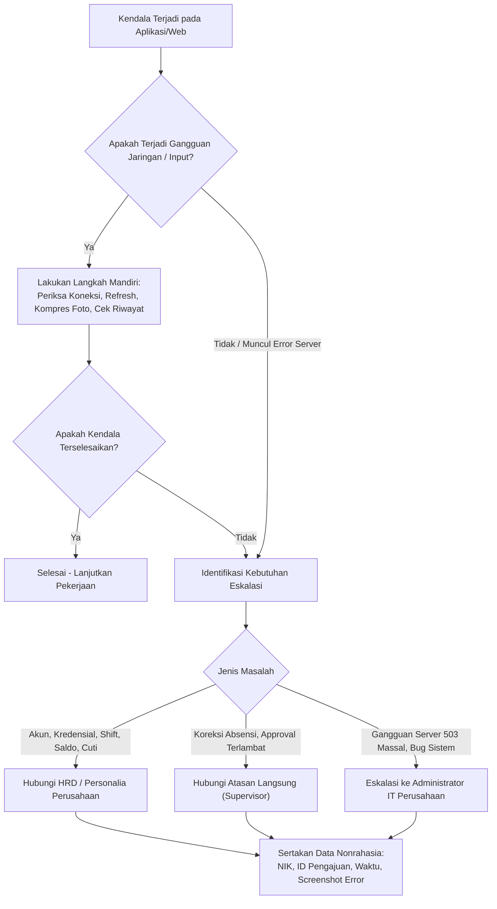

# Matriks Panduan Pemecahan Masalah (Troubleshooting Guide)

Tanggal Dokumen: 4 November 2026, Asia/Jakarta.  
Status Dokumen: **Matriks Resmi Diagnosa Kendala Operasional HR & Karyawan**.  
Acuan Spesifikasi: [`docs/hris-operational-guides-prd.md`](../hris-operational-guides-prd.md) Bagian 6.

---

## 1. Prinsip Utama Penanganan Kendala Operasional

Ketika terjadi gangguan teknis atau pesan kesalahan pada Dashboard Web maupun Aplikasi Mobile, seluruh pengguna dan administrator wajib mematuhi prinsip keselamatan data berikut:

> [!IMPORTANT]
> **Prinsip Aman Transaksi & Jaringan**:
> 1. **Periksa Status Riwayat Dahulu Sebelum Mengirim Ulang**: Jika koneksi internet terputus sesaat setelah Anda menekan tombol *Simpan* atau *Kirim*, **jangan langsung mengirim ulang berkali-kali**. Buka halaman riwayat atau muat ulang daftar untuk memastikan apakah permintaan sebelumnya sebenarnya sudah berhasil diterima dan diproses oleh server. Gangguan jaringan di sisi perangkat tidak menjamin data gagal tersimpan di server.
> 2. **Dilarang Mengambil Tindakan Destruktif**: Dilarang menghapus database, memanipulasi jam/tanggal perangkat, menghapus paksa penyimpanan sistem, atau meminta pembukaan izin akses publik tanpa otentikasi sebagai jalan pintas penanganan masalah.
> 3. **Lindungi Kerahasiaan Kredensial**: Saat melaporkan kendala kepada tim IT atau HRD, **jangan pernah menyertakan kata sandi, token otentikasi, kunci API, atau data pribadi sensitif**. Cukup berikan data operasional nonrahasia seperti NIK, ID Pengajuan, pesan error yang tampil, dan waktu kejadian.

---

## 2. Matriks Pemecahan Masalah Sistem

Tabel berikut memetakan 10 gejala umum, kemungkinan penyebab teknis, langkah mandiri yang aman, batas eskalasi ke HR/Admin, dan informasi nonrahasia yang perlu dilampirkan:

| No | Gejala / Pesan Kesalahan | Kemungkinan Penyebab Teknis | Langkah Aman Pengguna / Operator | Kapan Eskalasi ke HR/Admin | Data Nonrahasia untuk Dilaporkan |
|:---:|:---|:---|:---|:---|:---|
| 1 | **Login Ditolak / Sesi Berakhir** • *Email atau password salah* • *Sesi telah berakhir (401)* • *Akun tidak aktif/diarsipkan* | • Kesalahan ketik kredensial. • Token otentikasi kedaluwarsa. • Akun telah diarsipkan atau dinonaktifkan oleh HR. • Password direset oleh administrator pusat. | 1. Periksa tombol Caps Lock dan ketik ulang password secara teliti. 2. Pada mobile, lakukan login ulang dari halaman awal. 3. Bersihkan cache browser jika menggunakan web. | Jika login tetap gagal setelah 3 kali percobaan atau muncul pemberitahuan akun dinonaktifkan. | • Alamat email akun kerja. • NIK / Nama lengkap. • Tangkapan layar pesan error. *(Dilarang menyertakan password).* |
| 2 | **Konflik Data (HTTP 409 Conflict)** • *Data telah diubah oleh pengguna lain* • *Versi data tidak cocok (`expected_id` / `version`)* | • Dua pengelola HR mengedit karyawan/jadwal yang sama secara bersamaan. • Approval disetujui pihak lain saat layar masih terbuka. • Optimistic locking mendeteksi versi data di database lebih baru daripada yang tampil di layar. | 1. Jangan menekan tombol Simpan berulang kali. 2. Muat ulang halaman (F5) untuk mengambil data termutakhir yang telah disimpan rekan Anda. 3. Tinjau kembali perubahan terbaru sebelum mengulang input Anda. | Jika data form hilang atau terjadi kebingungan mengenai versi keputusan akhir yang sah. | • ID Pengajuan / NIK Karyawan. • Menu dan jam saat klik simpan. • Teks pesan error konflik yang muncul. |
| 3 | **Jadwal Kerja / Kalender Belum Siap** • Kartu Beranda: *Tanpa Shift* • Pesan: *Kalender kerja belum dikonfigurasi* | • Karyawan baru belum dipetakan ke penugasan shift efektif. • Tanggal kerja jatuh pada tanggal kalender yang belum diatur jam operasionalnya. • Tanggal efektif shift masa depan belum aktif. | 1. Pada mobile, tarik layar (Pull-to-Refresh) untuk memeriksa sinkronisasi data terbaru. 2. Jangan berasumsi bahwa status *Tanpa Shift* adalah hari bebas kerja. | Jika jam kerja Anda seharusnya aktif tetapi sistem masih menampilkan tanpa shift. | • NIK & Nama Karyawan. • Tanggal dan jam kerja yang dimaksud. • Unit kerja / Divisi penempatan. |
| 4 | **Kendala Lokasi GPS & Validasi QR** • *Di luar radius kantor* • *Izin lokasi/kamera ditolak* • *QR Code kedaluwarsa / beda tanggal* | • GPS smartphone dalam mode hemat daya atau akurasi rendah. • Izin akses lokasi/kamera pada perangkat belum diizinkan. • Berada di luar geofencing kantor. • QR yang dipindai bukan QR resmi hari ini (perbedaan `qr_date` vs `attendance_date`). | 1. Buka Pengaturan HP → pastikan Izin Lokasi dan Kamera bernilai *Izinkan saat aplikasi digunakan*. 2. Nyalakan GPS Mode Akurasi Tinggi. 3. Dekati titik tengah area kantor/lobi. 4. Minta pengawas kantor memperbarui tampilan QR resmi hari ini. | Jika Anda telah berada di lobi kantor dengan GPS akurat tetapi tetap ditolak oleh radius sistem. | • Jarak estimasi yang dilaporkan aplikasi. • Model perangkat & versi OS (Android/iOS). • Titik kantor / cabang kerja. |
| 5 | **Sesi Menggantung / Terkunci > 24 Jam** • Tombol absen tidak merespons • Status kehadiran terkunci | • Karyawan melakukan check-in tetapi lupa checkout hingga melewati 24 jam. • Sistem otomatis mengunci sesi menggantung demi menjaga integritas rekap absensi. | 1. **Dilarang** memanipulasi jam perangkat HP. 2. **Dilarang** menghapus data aplikasi HP. 3. Cukup tunggu dan laporkan sesi terbuka tersebut ke atasan. | Selalu membutuhkan eskalasi ke HR/Atasan untuk dilakukan tindakan **Koreksi Absensi**. | • NIK & Nama Karyawan. • Tanggal dan jam check-in sebenarnya. • Jam pulang fisik yang sebenarnya terjadi. • Alasan kelupaan checkout. |
| 6 | **Kendala Saldo Cuti & Hari Kerja Nol** • *Saldo cuti tidak mencukupi* • *Pengajuan 0 hari kerja / periode libur* • *Pengajuan tumpang tindih (overlap)* | • Alokasi kuota cuti tahunan belum dimasukkan di buku besar saldo oleh HR. • Rentang tanggal yang dipilih seluruhnya merupakan hari libur mingguan atau libur nasional. • Sudah ada pengajuan lain pada rentang tanggal yang sama. | 1. Periksa sisa saldo cuti pada modul pengajuan. 2. Pastikan tanggal mulai dan selesai bukan merupakan tanggal merah/libur resmi. 3. Periksa tab *Semua Pengajuan* untuk mengecek apakah tanggal tersebut pernah diajukan sebelumnya. | Jika saldo riil Anda berbeda dengan saldo yang tercatat di sistem atau alokasi saldo baru belum masuk. | • NIK & Nama Karyawan. • Jenis cuti yang dipilih. • Rentang tanggal pengajuan. • Tangkapan layar preview perhitungan saldo. |
| 7 | **Reviewer Tidak Tersedia / Menunggu Pihak Lain** • Pengajuan tertahan di tahap tertentu • *Menunggu pihak lain* • Status legacy: *needs_review* | • Karyawan belum memiliki atasan langsung (*manager_id* kosong). • Atasan langsung nonaktif/berhenti sehingga approval beralih menunggu admin. • Skema persetujuan memerlukan persetujuan berjenjang (Tahap 1 Supervisor belum selesai sehingga Tahap 2 HR belum dapat bertindak). | 1. Buka detail pengajuan pada aplikasi/dashboard. 2. Periksa kartu **Riwayat Tahap Persetujuan** untuk melihat peninjau mana yang saat ini sedang ditugaskan. 3. Jika berstatus *Menunggu Pihak Lain*, pengajuan sedang dalam antrean peninjau lain yang sah. | Jika atasan langsung telah nonaktif/berhenti kerja atau pengajuan tidak bergerak lebih dari 3 hari kerja. | • Nomor ID Pengajuan. • Tanggal pengajuan dibuat. • Nama peninjau yang tertera pada tahap berjalan. |
| 8 | **Gagal Unggah / Lampiran Privat 401/403** • *Ukuran file melebihi 2.048 KiB* • *Gagal memuat lampiran privat* • Akses ditolak (403) pada foto kuitansi | • Ukuran file kuitansi melebihi 2.097.152 byte. • Format file bukan JPG/PNG (misal PDF). • Token sesi habis saat mengunduh gambar. • Karyawan mencoba membuka kuitansi milik rekan kerja lain (ditolak oleh otorisasi server). | 1. Untuk unggah baru: kompres foto atau turunkan resolusi kamera agar ukuran di bawah 2 MB. 2. Jika gagal memuat lampiran pada detail: tekan tombol **Muat ulang lampiran**. 3. Jika muncul 401: lakukan logout dan login kembali. | Jika foto lampiran sah tidak dapat dibuka oleh peninjau yang berhak (Supervisor/HRD). | • ID Pengajuan Reimbursement. • Ukuran asli file gambar. • Pesan kesalahan yang muncul pada kartu lampiran. |
| 9 | **Beranda Gagal Dimuat / Gangguan Layanan** • *Gagal terhubung ke server* • HTTP 503 / Layanan Tidak Tersedia • Request Timeout | • Gangguan jaringan seluler lokal pengguna. • Server backend sedang dalam proses pemeliharaan berkala. • Waktu respons jaringan melebihi batas waktu (timeout). | 1. Periksa koneksi internet dengan membuka situs web lain. 2. Tarik layar ke bawah (Pull-to-Refresh) untuk mencoba kembali setelah beberapa saat. 3. **Penting**: Jangan panik, kegagalan memuat Beranda **bukan** berarti status absensi Anda hilang di server. | Jika pesan kesalahan berlangsung lebih dari 15 menit dan dialami oleh banyak karyawan secara bersamaan. | • Jam terjadinya kendala. • Nama penyedia internet / operator seluler. • Pesan error atau kode HTTP (503/Timeout). |
| 10 | **Perbedaan Angka pada Rekapitulasi Kehadiran** • Jam kerja total berbeda dari perkiraan • Hari kerja tidak sesuai ekspektasi | • Rekap mengecualikan hari libur kalender kerja resmi. • Filter rekap melebihi rentang batas 90 hari kalender. • Terdapat pengajuan izin berstatus `cancellation_requested` (tetap dianggap izin sampai HR menyetujui pembatalan). • Karyawan baru pindah unit organisasi (rekap menggunakan unit saat ini). | 1. Periksa rentang tanggal filter rekap (maksimal 90 hari per tarikan). 2. Buka tab pengajuan untuk memeriksa apakah ada izin sakit/cuti yang beririsan dengan hari kerja. 3. Cocokkan dengan kalender kerja libur nasional pada periode bersangkutan. | Jika setelah pencocokan manual masih ditemukan ketidaksesuaian logis pada jam kerja atau status kehadiran. | • Periode filter rekap (Tanggal Mulai - Tanggal Selesai). • NIK & Nama Karyawan yang diperiksa. • Baris data spesifik yang dipertanyakan beserta selisihnya. |

---

## 3. Alur Komunikasi dan Eskalasi Bantuan

> [!TIP]
> **Format Standar Laporan Kendala**:
> Saat mengirimkan tiket atau pesan bantuan ke HRD / IT, gunakan format ringkas berikut:
> - **Nama & NIK**: Budi Santoso (EMP-007)
> - **Platform**: Mobile Android (Samsung A52) / Dashboard Web (Chrome macOS)
> - **Waktu Kejadian**: 4 November 2026, pukul 08:15 WIB
> - **Modul & Menu**: Pengajuan Reimbursement (ID: 104)
> - **Deskripsi Singkat**: Menekan kirim pengajuan, jaringan sempat berputar lama, kuitansi ukuran 1,5 MB. Muncul pesan gagal terhubung.
> - **Tangkapan Layar**: *(Lampirkan gambar layar pesan kesalahan)*
